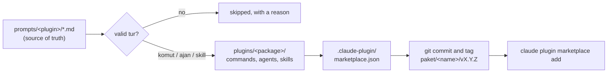
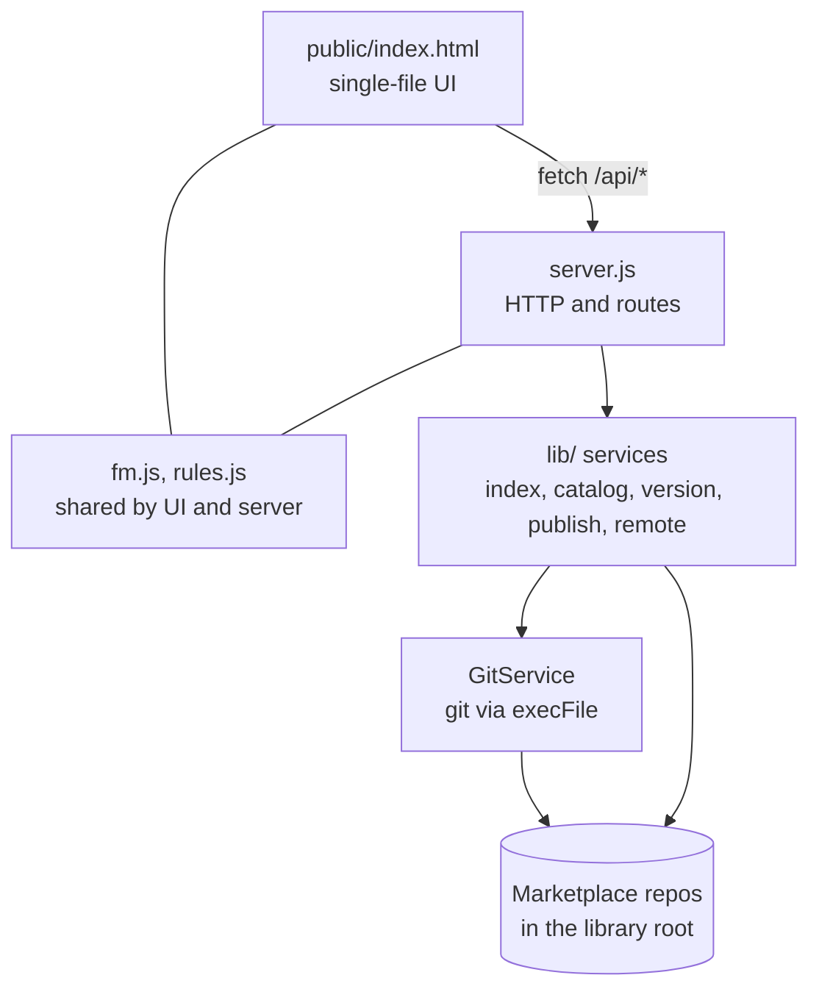

<p align="center">
  <a href="LICENSE"></a>
  
  
  
</p>

<p align="center">
  <a href="#quick-start">Quick start</a> &middot;
  <a href="#features">Features</a> &middot;
  <a href="#publishing-to-claude-code">Claude Code</a> &middot;
  <a href="#configuration">Configuration</a> &middot;
  <a href="CONTRIBUTING.md">Contributing</a>
</p>

**Prompt havuzu** ("prompt pool" in Turkish) is a local web app that keeps your prompts as plain Markdown files, gives each collection its own git repository, and publishes the ones you choose as a [Claude Code](https://claude.com/claude-code) plugin marketplace. It runs on your machine, needs only Node.js and git, and has no runtime dependencies.

> The interface is in Turkish. This README gives the English meaning of each Turkish label the first time it appears.

## Why

- **Prompts stay files.** Every prompt is one `.md` file with optional frontmatter. No database, no lock-in.
- **Git is the history.** Each marketplace folder is its own git repository, so every change, version and tag is plain git.
- **Local only.** The server listens on `127.0.0.1` and has no telemetry (see [Security and privacy](#security-and-privacy)).
- **Ships to Claude Code.** Prompts marked as command, agent or skill are converted into Claude Code plugins you can install in any project.
- **No build, no install step.** `node tools/ui/server.js` is all it takes.

## Features

- **Marketplace, Plugin, Prompt tree** across several marketplaces at once, with keyboard navigation and context menus.
- **Search** that ignores case and Turkish diacritics, plus filters (press `Ctrl+K`).
- **Frontmatter editor** that preserves unknown keys and formatting, so git diffs stay small.
- **Save and commit in one step:** fill the commit message box (**Commit mesajı**) and save; only that file is committed. A Git panel handles the rest.
- **Per-prompt history tab** (**Geçmiş**): commits, diffs, version tags, and restoring an older version into the editor.
- **Prompt versions:** the **+1** button bumps `versiyon`, commits only that file and creates an annotated tag `prompt/<name>/vX.Y.Z`.
- **Variables:** `{{variable}}` placeholders; **Kopyala** (Copy) asks for values and copies the filled text.
- **Import** of old `.txt` files (**İçe aktar**), **move** between plugins and marketplaces, rename, tags. Deleting moves files to `.pp/trash/`; there is no permanent delete.
- **Package publishing** to `plugins/<package>/`, with a stated reason for every prompt that is skipped.
- **Remote repositories:** add or edit a remote, check it, push (including pending tags), update by fast-forward only, and clone a marketplace from a Git URL.

## Quick start

Requirements: **Node.js 18 or newer** and **git** on your `PATH`. Git is mandatory: without it the setup check reports "Git bulunamadı" (git not found) and blocks the app.

```bash
git clone https://github.com/kaanturker61/prompt-havuzu.git
cd prompt-havuzu
node tools/ui/server.js --open
```

Launchers are included: `start.bat` (Windows) and `./start.sh` (macOS, Linux). Both run the same command. The app starts on port 4317 (if taken, the next 10 ports are tried) and `--open` opens your browser.

On first run the app shows a setup screen (**Kuruluma devam et**, continue setup). Open **Ayarlar** (Settings) and choose a **library root**: a folder **outside** this repository where your marketplaces will live. You can let the app create it.

## Usage

1. **Pick the library root** in **Ayarlar**. Every folder under it is a separate marketplace and a separate git repository.
2. **Create a marketplace** with **+ Marketplace**. This runs `git init` (branch `main`) and writes the skeleton. No commit is made automatically. The same dialog can clone from a remote instead (**Uzak depodan klonla**).
3. **Add a plugin and prompts** with **+ Plugin** and **+ Prompt**. A plugin is a folder under `prompts/` and becomes a plugin of the same name when published.
4. **Edit, commit, version.** Edit the frontmatter and body, write a commit message, press the save button (**Kaydet**, `Ctrl+S`). Use **+1** to cut a prompt version and the **Geçmiş** tab to review history.
5. **Publish and install.** Set `tur` (type) to `komut`, `ajan` or `skill`, open the package page, and press **Yayınla** (Publish). Then add the marketplace in Claude Code (next section).

<details>
<summary>Tree details</summary>

- The tree has three levels: **Marketplace**, **Plugin**, **Prompt**. Clicking a node makes that marketplace the **active** one. The editor, Git panel, versions, import and publishing act on the active marketplace; the tree, search and filters cover all of them.
- Special nodes: **Klasörsüz promptlar** (loose prompts directly in `prompts/`), **Gelen kutusu** (inbox, `prompts/gelen-kutusu`, never published) and **Teknik dosyalar** (technical files such as `plugins/`, `.claude-plugin/` and `pp.config.json`).
- Plugin names cannot start with reserved prefixes such as `claude-` or `anthropic-`.
- Folders without a git repository are listed separately and can be initialised with **Git'i başlat** (Initialise git).
- Moving a prompt to another marketplace leaves its history and tags in the source repository; the target sees a new, uncommitted file.

</details>

## Publishing to Claude Code

Source prompts live in `prompts/`. Publishing generates the `plugins/` and `.claude-plugin/` output, which you should not edit by hand.



**Yayınla** on the package page writes the plugin output, updates `plugin.json` and `marketplace.json`, commits those files, creates the annotated tag `paket/<name>/vX.Y.Z` and can push to a remote. **Marketplace'i güncelle** (update marketplace) regenerates all packages without bumping versions, tagging or pushing. Both refuse to run while prompt changes are uncommitted.

In your projects:

```bash
claude plugin marketplace add <marketplace-folder-or-git-url>
claude plugin install <package>@<marketplace>
claude plugin marketplace update <marketplace>
claude plugin validate <marketplace-folder>
```

Claude Code's command syntax can change between versions. When in doubt, run `claude plugin --help`.

<details>
<summary>Why a prompt is not published</summary>

A prompt that cannot be published is never dropped silently. Reasons shown in the UI:

| Code | Meaning |
|---|---|
| `turYok` | Publish fields are filled but `tur` is missing |
| `turGecersiz` | `tur` is not `komut`, `ajan` or `skill` |
| `onYuzKapanmamis` | Frontmatter is not closed (no second `---`) |
| `dosyaBuyuk` | File is larger than 2 MB |
| `yayinDisi` | No `tur`: intentionally not published |
| `durumHaric` | `durum` (status) is not in the marketplace's `export.durumlar` list |
| `paketDisiKlasor` | Folder is not part of a package (inbox or excluded folder) |

</details>

## Prompt files

Every prompt is a Markdown file. All fields are optional and unknown keys are left untouched. Example:

```markdown
---
baslik: Code review
etiketler: [review, git]
durum: kararlı
versiyon: 1.0.0
tur: komut
paket: ornek
komut_adi: review
aciklama: Review the staged changes
izinli_araclar: Bash(git diff:*), Read
model: sonnet
---
Review the staged changes with this focus: {{focus}}
```

| Field | Purpose |
|---|---|
| `baslik`, `etiketler`, `projeler`, `olusturma` | Title, tags, projects it is used in, creation date |
| `durum` | Status: `taslak` (draft), `kararlı` (stable), `arşiv` (archive) |
| `versiyon` | Last released version as `X.Y.Z`; set by **+1** (an empty field becomes `1.0.0` on the first bump) |
| `tur` | `komut` (command), `ajan` (agent) or `skill`; required to publish |
| `paket` | Plugin the prompt belongs to; new prompts get their folder name |
| `komut_adi`, `aciklama`, `arguman_ipucu`, `izinli_araclar`, `model` | Converted to Claude Code frontmatter (for example `izinli_araclar` becomes `allowed-tools` or `tools`) |

## Configuration

User settings (`libraryRoot`, `activeMarketplace`, `remoteCheck`) live in a JSON file:

| OS | Path |
|---|---|
| Windows | `%APPDATA%\prompt-havuzu\config.json` |
| macOS | `~/Library/Application Support/prompt-havuzu/config.json` (or `$XDG_CONFIG_HOME/prompt-havuzu/config.json` if set) |
| Linux | `$XDG_CONFIG_HOME/prompt-havuzu/config.json`, otherwise `~/.config/prompt-havuzu/config.json` |

| Option | Effect |
|---|---|
| `PP_CONFIG=<file>` | Overrides the settings file location on every platform |
| `--port <n>` or `PORT=<n>` | Port, default `4317`; the next 10 ports are tried if it is taken |
| `--open` | Open the browser on start |

The old `--root` flag and `PROMPT_ROOT` variable were removed; choose the library root in **Ayarlar**. That dialog also has "Uzak depoyu kontrol et" (check the remote): on startup (at most once per hour) or manually only.

Each marketplace has a `pp.config.json`, written by the UI, with `libraryDir` (new marketplaces use `prompts`), `marketplace` (`name`, `owner`, `plugin`, `description`, `version`), `packages`, and `export` (`durumlar`, `haricKlasorler`).

<details>
<summary>Marketplace folder layout</summary>

```text
<library root>/
  <marketplace>/            # its own git repository
    prompts/                # source of truth (libraryDir)
      <plugin>/*.md
      gelen-kutusu/         # inbox, never published
    plugins/                # generated by publishing
    .claude-plugin/         # generated marketplace.json
    .pp/trash/              # deleted files, not tracked by git
    pp.config.json
```

</details>

## Security and privacy

- The server binds to `127.0.0.1` only and rejects requests whose `Host` is not `127.0.0.1`, `localhost` or `[::1]`.
- Every non-GET request to `/api/*` needs the `X-PP: 1` header, and an `Origin` header, if present, must match the host.
- The served page carries a strict Content-Security-Policy (`default-src 'self'`, no framing); only three static files are served.
- File access is confined to the active marketplace and refuses `.git`. Git runs via `execFile` without a shell.
- There is no telemetry and no HTTP client in the code. The only network traffic is git talking to remotes **you** configure: clone, check, push and update. The startup remote check only runs when a remote exists and can be switched to manual.

To report a vulnerability, see [SECURITY.md](SECURITY.md).

## Architecture



`server.js` is a dependency-free HTTP server. Services in `tools/ui/lib/` receive their dependencies through constructors, and only `GitService` knows git commands. `fm.js` (frontmatter parser and writer) and `rules.js` (naming, versioning and publish rules) run in both Node and the browser, so both sides share one implementation.

## Development

```bash
npm test --prefix tools/ui
```

This runs `node --test` with no dependencies. Tests use temporary folders and `PP_CONFIG` only, with git configuration isolated, so they never touch your real settings or library.

```text
tools/ui/
  server.js       HTTP server and routes
  lib/            server-side services
  public/         index.html, fm.js, rules.js
  test/           node:test suites
start.bat, start.sh     launchers
```

## Troubleshooting

- **The setup screen keeps appearing:** open **Ayarlar**, choose a library root, and make sure git is installed and on `PATH`.
- **The library root is rejected:** it cannot be inside this tool's own repository; pick a folder elsewhere.
- **Port in use:** the app tries the next 10 ports, or pass `--port <n>`.
- **Publish refuses to run:** commit your prompt changes first.
- **Push or clone fails:** the error dialog shows the git output; check credentials and the remote URL.

## Contributing

Issues and pull requests are welcome. Please read [CONTRIBUTING.md](CONTRIBUTING.md) and the [Code of Conduct](CODE_OF_CONDUCT.md) first.

## License

[MIT](LICENSE) &copy; Kaan TÜRKER

The license covers this tool. Your prompts live in your own marketplace repositories, outside this repository, and are not covered by it: choose a license for them separately (for example CC-BY-4.0 or CC0 for shared prompts) and add a `LICENSE` file to each marketplace you publish.
